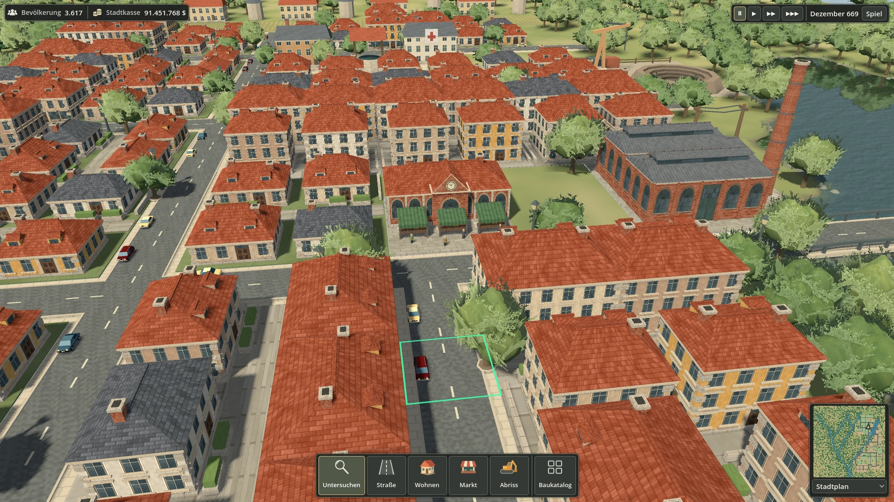
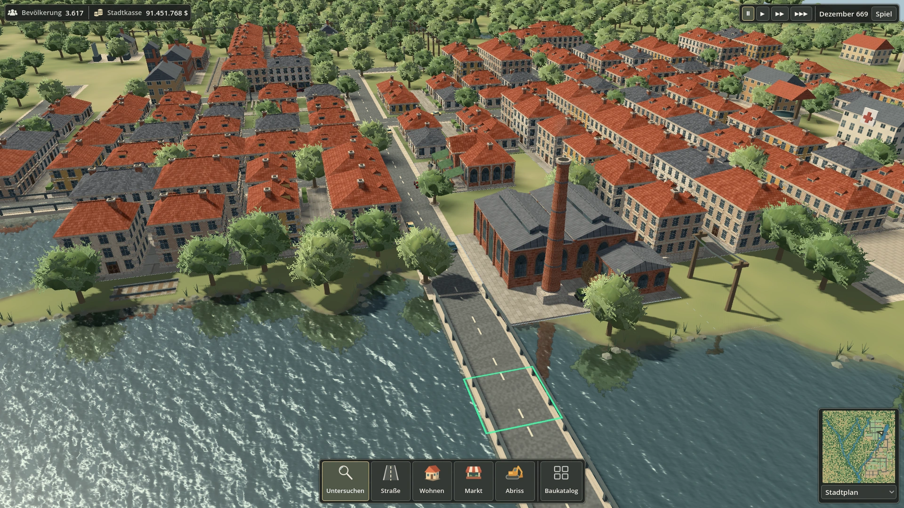

# LinCity-NG in 3D spielen

Im Hauptmenü lässt sich eine neue Stadt anlegen, ein Szenario auswählen, ein Spielstand laden oder die zuletzt gesicherte Stadt fortsetzen. Das Flussviertel ist als „Kleinstadt am Fluss“ unter „Neues Spiel“ verfügbar. Godot 4.5.1 zeichnet die frei drehbare Stadt mit OpenGL. RustCity verwaltet Simulation, Baukosten, Handel und Spielstände.

„Spiel → Pausenmenü“ hält die Simulation an. „Fortfahren“ setzt die laufende Stadt fort. Beim Wechsel zum Hauptmenü und beim regulären Beenden sichert das Spiel die Stadt für „Fortsetzen“. Ein Fehler beim Sichern wird im Pausenmenü angezeigt. Unter „Spiel laden“ lassen sich auch Spielstände der klassischen Oberfläche öffnen.

## Start aus den Quellen

Für den Linux-Build werden ein C++20-Compiler für die Godot-Anbindung, CMake, Cargo und die Kernbibliotheken des Projekts benötigt. CMake verwendet die im Projekt festgelegte Version von godot-cpp. Die vorbereiteten GLB-Dateien sind im Repository enthalten. Zum Spielen genügt der Godot-Editor mit der passenden Erweiterung. [Abhängigkeiten](DEPENDENCIES.md)

```sh
cmake -S . -B build/godot-editor -DLINCITY_BUILD_GUI=OFF -DLINCITY_BUILD_GODOT=ON -DBUILD_TESTING=OFF -DCMAKE_BUILD_TYPE=Release
cmake --build build/godot-editor --target lincity_godot --parallel
godot --headless --path godot --import
godot --path godot
```

Mit `godot --path godot -- --bridge-view` startet das Flussviertel direkt von der Brückenseite. Mit `--city=/absoluter/pfad/stadt.gz` hinter dem doppelten Bindestrich startet Godot direkt in diesem Spielstand.

| Aktion | Bedienung |
|---|---|
| Blick drehen und neigen | Rechte Maustaste ziehen, Q und E zum Drehen |
| Verschieben und zoomen | Mittlere Maustaste ziehen, WASD oder Pfeiltasten, Mausrad zum Zoomen |
| Untersuchen, Straße, Wohnen, Markt, Abriss | Tasten 1 bis 5 oder Bauleiste |
| Weitere Werkzeuge und Kartenebenen | B für den Baukatalog, Auswahl unter der Minikarte für die Kartenebene |
| Verkehrsweg bauen | Linke Maustaste ziehen, Strg wechselt den Knick im Verlauf |
| Hilfe und Spielstände | F1 für die Hilfe, F9 zum Schnellladen, F12 zum Schnellspeichern |
| Verlauf und Siegziele | Spiel → Verlauf und Nachhaltigkeit |
| Anzeige, Ton und Startvorgaben | Spiel → Einstellungen |

Die Nachhaltigkeitsansicht zeigt den Fortschritt aller sechs Siegkriterien. Die Verlaufsdiagramme lesen die abgeschlossenen Monate aus dem Spielstand und zeigen fehlende ältere Aufzeichnungen als Lücken. Ein erfolgreicher letzter Evakuierungsflug und eine nachhaltige Wirtschaft öffnen jeweils einen eigenen Siegdialog.

Unter „Einstellungen“ lassen sich Musik und Effekte getrennt ein- und ausschalten und regeln. Die Titelauswahl berücksichtigt den Technologiestand der Stadt. Das Startargument `--mute` hinter dem doppelten Bindestrich schaltet die Sitzung stumm. Die Einstellungen werden lokal gespeichert. Die 3D-Oberfläche und Spielhilfe sind auf Deutsch. Unter X11 lässt sich die Fensterauflösung im Menü wählen. Unter Wayland wird die Fenstergröße über den Fenstermanager geändert. Vollbild steht auf beiden Plattformen zur Verfügung.

## Assets und Referenzviertel

Eine Kartenzelle entspricht einer Godot-Welteinheit. Der Modellkatalog verbindet die Gruppen des Spielkerns mit den Gebäude-, Verkehrs- und Geländevarianten. Beim Platzieren bestimmt die Straßenanbindung die Vorderseite. Für das Bild entscheidende Fassaden, Dächer und Rückseiten sind ausmodelliert. Auswahlkörper und vereinfachte Fernmodelle werden separat exportiert. Die Bau- und Terrainmodelle werden lokal erzeugt und mit dem Projekt verteilt. [Blender-Quellen und Export der Architektur](../tooling/art/architecture/README.md) · [Katalog und Modellzuordnung](../godot/world/model_catalog.gd)

Die folgenden Befehle erzeugen die übrigen Katalogmodelle beziehungsweise den Spielstand aus „Good Times“ neu. Der Spielstand entsteht durch dieselben Landschafts- und Bauaktionen wie im laufenden Spiel.

```sh
godot --headless --path godot -s res://world/authoring/bake_models.gd
godot --headless --path godot -s ../tooling/art/build_riverside.gd
```

## Linux-Export

Die Linux-Releasevorlage muss zur installierten Godot-Version passen. Der Editor und das exportierte Spiel erhalten jeweils die passende native Bibliothek. Zusätzlich zum Editor-Build die Release-Erweiterung bauen und das Paket in einem neuen Zielverzeichnis erstellen.

```sh
cmake -S . -B build/godot-template-release -DLINCITY_BUILD_GUI=OFF -DLINCITY_BUILD_GODOT=ON -DBUILD_TESTING=OFF -DCMAKE_BUILD_TYPE=Release -DGODOTCPP_TARGET=template_release
cmake --build build/godot-template-release --target lincity_godot --parallel
python3 tooling/release/package_godot_linux.py --godot godot --libxmlpp-source /pfad/zum/libxml++-5.4.0.tar.xz --output build/godot-linux-final --graphics
```

Das Quellarchiv muss zur eingebundenen libxml++-Version passen. Die Paketierung verwendet Python, patchelf und ldd. Sie prüft Spielstart, PCK, Bibliotheken, Credits und Spielstand aus einem frischen Arbeitsverzeichnis. Die Datei `LIESMICH.txt` im Paket nennt die erforderlichen Linux-Systembibliotheken.

## Prüfung

```sh
godot --headless --path godot -s res://tests/model_catalog.gd
godot --headless --path godot -s res://tests/session.gd -- --mute
godot --headless --path godot -s res://tests/hud.gd -- --mute
godot --headless --path godot -s res://tests/acceptance.gd -- --mute
godot --headless --path godot -s res://tests/outcomes.gd -- --mute
godot --headless --path godot -s res://tests/history.gd -- --mute
godot --headless --path godot -s res://tests/audio.gd
godot --headless --path godot -s res://tests/settings.gd
godot --path godot -s res://tests/benchmark.gd
```

Der Benchmark lädt „Rocket 98“, startet die Simulation und dreht die Kamera bei 1920 × 1080 Pixeln. Nach je 100 Aufwärmbildern werden 400 Bilder der Nahansicht und 400 der Stadtübersicht gemessen. Der GPU-Test verlangt höchstens 33,33 ms am 95. Perzentil in beiden Ansichten. Für die beiden festen Marktansichten den Ordner für die Aufnahmen über `LINCITY_CAPTURE_DIR` setzen und `res://tests/riverside_views.gd` mit einem Grafiktreiber starten.

## Aufnahmen aus dem Linux-Export

Beide Aufnahmen zeigen denselben Spielstand während einer Arbeitsschicht der Leichtindustrie. Die Marktstraße führt zur Halle mit den drei grünen Markisen. Von der Brücke aus sind ihre Seitenfassade, der Fabrikhof und die Spiegelung des Schornsteins sichtbar. Die grüne Kontur zeigt das mit dem Werkzeug „Untersuchen“ anvisierte Feld.





## Ergebnis der Abnahme am 19. November 2026

Das separat entpackte Linux-Release wurde auf einer GeForce RTX 3060 Ti mit Treiber 620.70.06 geprüft. Die folgende Messung verwendet das Szenario „Rocket 98“ mit 100 × 100 Feldern, laufender Rust-Simulation und vollständigem HUD. Jede Stichprobe wartet auf das gezeichnete Bild einschließlich Rücklesen des Framebuffers.

| Renderer | Nahansicht Median | Nahansicht P95 | Stadtübersicht Median | Stadtübersicht P95 |
|---|---:|---:|---:|---:|
| RTX 3060 Ti, gepacktes Release | 6,59 ms | 12,26 ms | 7,64 ms | 12,67 ms |
| Mesa llvmpipe, Ryzen 5 5600, Editorlauf | 606,89 ms | 676,64 ms | 355,24 ms | 370,64 ms |

Das Release erreicht auf der RTX das Ziel von 33,33 ms in beiden Ansichten. Auf dem Testrechner steht eine physische GPU zur Verfügung. Der zusätzliche Softwarelauf mit Mesa 26.2.6 auf der CPU überschreitet das Ziel. Die Leistung auf einer schwächeren physischen GPU ist offen.

Die Katalogprüfung erfasst 185 Varianten mit drei Detailstufen und separaten Auswahlkörpern für anwählbare Modelle. Die Spielprüfung deckt den Markt aus vier Kamerarichtungen, Straßenbau und Abriss über eine Bereichsgrenze, Kosten, Kartenebenen, Rauch bei laufender Produktion, Raketenstart und das Weiterspielen eines gespeicherten Stands ab. Der entpackte Export wurde zusätzlich mit echten Mauseingaben, allen Lizenzansichten und einem regulären Grafikstart aus einem frischen Verzeichnis geprüft.

## Nachprüfung der erweiterten Oberfläche

Im separat entpackten Linux-Paket wurden alle sieben Startstädte und die Kartenerzeugung in allen vier Klimazonen geprüft. Die Bedienprüfung umfasst Handel, normale und schnelle Spielstände sowie die Kostenbestätigung beim Abriss. Die Einstellungen wurden unter X11 und Wayland getestet. Für den Verlauf wurden gemessene Daten, echte Nullwerte, Lücken aus Altspielständen und ein erneuter Speicherzyklus geprüft.

Die beiden Siege und die Niederlage wurden mit je einem vorbereiteten Spielstand über den tatsächlichen Simulationsschritt und den Spielausgangsdialog geprüft. Ein Langzeitdurchlauf ab einer neu erzeugten Stadt bis zum Sieg steht als Test aus. Der aktualisierte Linux-Export erreicht in „Rocket 98“ auf der RTX 3060 Ti bei 1920 × 1080 ein P95 von 11,16 ms in der Nahansicht und 13,28 ms in der Stadtübersicht.

## Apple-Silicon-Testbuild

Das Testpaket für macOS 15 oder neuer enthält `LinCity-NG.app`, die ARM64-Rust-Anbindung und die benötigte libxml++-Bibliothek. Das ZIP im Finder entpacken und die App aus dem Paketordner öffnen. Die App ist ad hoc signiert. Falls Gatekeeper den ersten Start blockiert, kann die App unter „Systemeinstellungen → Datenschutz & Sicherheit“ über „Dennoch öffnen“ freigegeben werden.

Der Cross-Build auf Linux verwendet Clang, LLD, das macOS-15.5-SDK und Rusts Ziel `aarch64-apple-darwin`. Für den Export benötigt [das Paketierskript](../tooling/release/package_godot_macos.py) die bereits gebaute Release-Erweiterung, Godot 4.5.1 und dessen `macos.zip`-Vorlage sowie LLVM-Werkzeuge und rcodesign. Das Skript extrahiert ARM64 aus der offiziellen Universalvorlage, bündelt die Bibliotheken, prüft deren Ladepfade und signiert die fertige App. Das SDK ist kein Bestandteil des Testpakets.

## Windows-x64-Testbuild

Das ZIP für Windows 10 und 11 auf x64 vollständig entpacken und `LinCity-NG.exe` öffnen. PCK und DLLs bleiben neben der EXE. Die EXE hat keine Authenticode-Signatur.

Für den Cross-Build auf Linux LLVM-MinGW mit UCRT und das Rust-Ziel `x86_64-pc-windows-gnullvm` verwenden. Die Windows-Versionen von zlib, libxml2, libxml++ und fmt müssen im Zielpräfix liegen. Die CMake-Toolchain setzt `CMAKE_SYSTEM_NAME=Windows`, `CMAKE_SYSTEM_PROCESSOR=x86_64`, die x86_64-Compiler von LLVM-MinGW und den Suchpfad für Zielbibliotheken. `PKG_CONFIG_LIBDIR` verweist auf die pkg-config-Dateien des Windows-Zielpräfixes. Für Cargo verweist `CXX_x86_64_pc_windows_gnullvm` auf denselben C++-Compiler.

```sh
cmake -S . -B build/godot-windows-x64 -DCMAKE_TOOLCHAIN_FILE=/pfad/windows.cmake -DLINCITY_BUILD_GUI=OFF -DLINCITY_BUILD_GODOT=ON -DBUILD_TESTING=OFF -DCMAKE_BUILD_TYPE=Release -DGODOTCPP_TARGET=template_release -DGODOTCPP_USE_STATIC_CPP=OFF
cmake --build build/godot-windows-x64 --target lincity_godot --parallel
```

[Das Paketierskript](../tooling/release/package_godot_windows.py) verwendet Godot 4.5.1 mit der installierten Windows-x64-Exportvorlage und `llvm-objdump`. Es übernimmt die benötigten DLLs aus den mit `--dll-path` angegebenen Verzeichnissen des Zielpräfixes und von LLVM-MinGW. Mit `--libxmlpp-source` und `--license` werden das passende libxml++-Quellarchiv und die Lizenzdateien der verwendeten Bibliotheken mitgeliefert.
