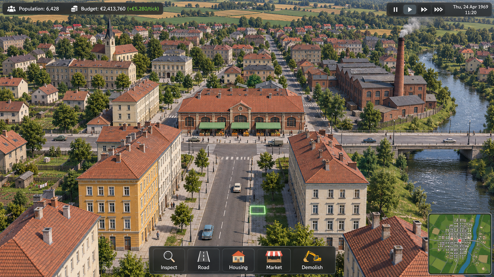
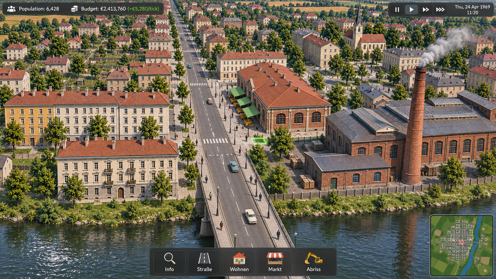

# LinCity-NG als frei drehbare 3D-Stadt

Freigegebenes Konzept vom 19. November 2026. LinCity-NG erhält eine native Desktop-Oberfläche in Godot 4. Vorbild ist das Stadtgefühl von *Cities: Skylines*. Der Funktionsumfang richtet sich nach dem bestehenden Spiel.

## Stadtbild und Kamera

Eine gewachsene mitteleuropäische Kleinstadt bildet das gestalterische Leitbild. Hauseingänge und Fassaden folgen der Straße. Die Markthalle öffnet sich mit ihren grünen Markisen zum Vorplatz. Hallendächer und ein Schornstein machen das Industrieviertel am Fluss schon aus der Entfernung erkennbar.

Die Kamera dreht sich frei um 360 Grad. Beim Drehen und Zoomen bleibt der gewählte Ort im Fokus. Eine steilere Ansicht erleichtert das Bauen. Ein flacherer Blickwinkel zeigt die Straßenflucht. Die zweite Ansicht veranschaulicht, wie Markt und Schornstein nach einer Drehung von der Flussseite aus Orientierung geben.

Beide Bilder sind Stilentwürfe. Für Gebäudegrundrisse, Straßenverlauf, Beschriftungen und angezeigte Werte ist der tatsächliche Spielstand maßgeblich.

## Bauen und Bedienen

Die Stadt füllt den Bildschirm. Die Bauleiste bündelt die vorhandenen Werkzeuge am unteren Rand. Oben stehen Spielzeit, Geld und Zeitsteuerung. Die Minikarte sitzt unten rechts. Die Auswahl eines Gebäudes öffnet seine Auskunft am Rand und lässt das Grundstück sichtbar.

Bauvorschau und Platzierung verwenden dieselben Kartenfelder. Beim Ziehen einer Straße bleibt ihr Verlauf aus jedem Kamerawinkel erkennbar. Bei aktiver Kartenebene treten die Materialfarben zurück, damit etwa die Umweltbelastung auf den betroffenen Feldern lesbar ist. Tastaturbedienung, Hilfe, Dialoge und Spielstände gehören zum Desktop-Entwurf.

## Anbindung und Abnahme

Gewählt wurde eine neue Godot-Oberfläche. Ein Umbau des bestehenden SDL-Renderers hätte die Wiederverwendung der bisherigen Dialoge erleichtert. Für Godot sprach die Möglichkeit, Kamera, Stadtmodelle, Materialien und Beleuchtung gemeinsam in einer Szene zu gestalten. Eine native Erweiterung übermittelt Spielzustand und Befehle zwischen Godot und dem Rust-Simulationskern. Der Kern entscheidet über Zulässigkeit und Kosten und übernimmt das Laden und Speichern.

Als Referenz dient ein Viertel mit Wohnstraße, Markt, Industrie und Flussbrücke. Für die spätere Abnahme muss derselbe Markt aus vier Richtungen auswählbar sein. Eine gezogene Straße muss mit Vorschau, belegten Feldern und abgebuchten Kosten übereinstimmen. Ein bestehender Spielstand muss sich laden, weiterspielen und erneut speichern lassen.

## Leistungseinschätzung

Im Prototyp wurde das Szenario „Rocket 98“ mit 100 × 100 Feldern bei laufender Simulation vermessen. Unter Godot 4.5.1 mit dem OpenGL-Kompatibilitätsrenderer auf einer GeForce RTX 3060 Ti bei 1920 × 1080 Pixeln ergaben sich über jeweils 400 Bilder während einer Kameradrehung folgende Bildzeiten.

| Ansicht | Median | 95. Perzentil |
| --- | ---: | ---: |
| Nahansicht | 6,91 ms | 7,95 ms |
| Stadtübersicht | 8,01 ms | 10,34 ms |

Die Messung belegt die Machbarkeit für die vereinfachten Modelle des Prototyps auf diesem Rechner. Für die spätere grafische Abnahme ist die Messung mit dem angestrebten Detailgrad und auf schwächerer Hardware zu wiederholen.
